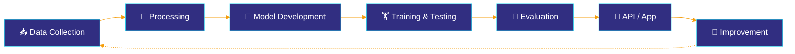

<div align="center">


<br/>

<a href="https://www.linkedin.com/in/hadia-waheed-1647892aa/"></a>
<a href="mailto:hadiawaheed5@gmail.com"></a>
<a href="https://github.com/HadiaWaheed"></a>


</div>


## 👩‍💻 About Me

Hi, I'm **Hadia Waheed** 👋, an **AI/ML Engineer** who loves building intelligent systems, training models and shipping practical AI applications.

I explore how **Machine Learning, Deep Learning and Large Language Models** solve real-world problems, from data exploration and experimentation to semantic retrieval, LLM integration and backend development.

```python
class HadiaWaheed:
    role      = "AI/ML Engineer"
    focus     = ["LLMs", "RAG", "NLP", "Deep Learning", "Generative AI"]
    mindset   = "Learn. Build. Experiment. Improve."
    currently = "Building something new 🚀"
```

<div align="center">

| 🔭 Currently Exploring | 🌱 Currently Learning | 💬 Ask Me About |
|:---:|:---:|:---:|
| RAG pipelines & vector search | LLM fine-tuning & evaluation | ML, NLP, Transformers |

</div>

## 🎯 Focus Areas

<div align="center">

| 🤖 Machine Learning | 🧠 Deep Learning | ✨ Generative AI |
|:---:|:---:|:---:|
| Model Training | Neural Networks | LLMs |
| Classification | Transformers | RAG Systems |
| Evaluation | Fine-Tuning | Semantic Search |

</div>

## 🛠️ Tech Stack

<div align="center">


<br/><br/>


</div>

**🧩 AI Concepts:** `LLMs` · `RAG` · `Transformers` · `Sentence Embeddings` · `Vector Search` · `Prompt Engineering` · `Fine-Tuning & Evaluation`

## 🚀 Featured Projects

<table>
<tr>
<td width="50%" valign="top">

### 🛡️ PolyGuard
**AI-Powered Code Vulnerability Detection**

  

Multilingual vulnerability detection using transformer-based deep learning.

- GraphCodeBERT classification
- Model fine-tuning & evaluation
- Multilingual source-code analysis
- API integration for code scanning

**Stack:** Python · PyTorch · Flask · PostgreSQL

🔗 [**View Repository →**](https://github.com/HadiaWaheed/PolyGuard)

</td>
<td width="50%" valign="top">

### 📚 Comparative Religion RAG
**Knowledge Q&A System**

  

Q&A app over a curated collection of books and documents.

- PDF processing & text extraction
- Chunking & embedding generation
- FAISS semantic vector retrieval
- Gemini-powered answers

**Stack:** Python · FAISS · Sentence Transformers · Gemini · FastAPI

🔗 [**View Repository →**](https://github.com/SENODROOM/ComparativeReligionBooks)

</td>
</tr>
<tr>
<td colspan="2" valign="top">

### 🔍 FlyRank ML
**Search Data Analysis & Predictive Modeling**

  

Exploratory data analysis, ML task framing, baseline models, experiment comparison and performance evaluation.

**Stack:** Python · Pandas · Scikit-learn · Jupyter Notebook

🔗 [**View Repository →**](https://github.com/HadiaWaheed/flyrank-ml-internship)

</td>
</tr>
</table>

## 🔄 How I Build AI Systems



I focus on the complete workflow behind intelligent systems: not just using AI models, but understanding how they are built, evaluated and integrated into real applications.

## 📊 GitHub Analytics

<div align="center">


<br/><br/>


<br/><br/>


</div>


<div align="center">

<br/>

*"Great engineering is not just about writing code.<br/>It is about understanding problems, exploring ideas, and building solutions that make a difference."*

<br/>

### 🤝 Have an AI idea, project or collaboration in mind? Let's connect!

<a href="https://www.linkedin.com/in/hadia-waheed-1647892aa/"></a>
<a href="mailto:hadiawaheed5@gmail.com"></a>
<a href="https://github.com/HadiaWaheed"></a>

<br/><br/>

**THANK YOU FOR VISITING MY PROFILE** 💙

</div>


