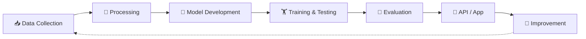

<div align="center">

<h1>⚡ HADIA WAHEED ⚡</h1>

<h3>🧠 AI / ML Engineer &nbsp;•&nbsp; LLMs &nbsp;•&nbsp; Generative AI &nbsp;•&nbsp; RAG</h3>

<p><i>Learn &nbsp;•&nbsp; Build &nbsp;•&nbsp; Experiment &nbsp;•&nbsp; Improve</i></p>

<a href="https://www.linkedin.com/in/hadia-waheed-1647892aa/"><b>🔗 LinkedIn</b></a> &nbsp;|&nbsp;
<a href="mailto:hadiawaheed5@gmail.com"><b>✉️ Email</b></a> &nbsp;|&nbsp;
<a href="https://github.com/HadiaWaheed"><b>💻 GitHub</b></a>

</div>

<br/>

---

## 👩‍💻 About Me

Hi, I'm **Hadia Waheed** 👋, an **AI/ML Engineer** who loves building intelligent systems, training models and shipping practical AI applications.

I explore how **Machine Learning, Deep Learning and Large Language Models** solve real-world problems, from data exploration and experimentation to semantic retrieval, LLM integration and backend development.

```python
class HadiaWaheed:
    role      = "AI/ML Engineer"
    focus     = ["LLMs", "RAG", "NLP", "Deep Learning", "Generative AI"]
    mindset   = "Learn. Build. Experiment. Improve."
    currently = "Building something new 🚀"
```

<div align="center">

| 🔭 Currently Exploring | 🌱 Currently Learning | 💬 Ask Me About |
|:---:|:---:|:---:|
| RAG pipelines & vector search | LLM fine-tuning & evaluation | ML, NLP, Transformers |

</div>

---

## 🎯 Focus Areas

<div align="center">

| 🤖 Machine Learning | 🧠 Deep Learning | ✨ Generative AI |
|:---:|:---:|:---:|
| Model Training | Neural Networks | LLMs |
| Classification | Transformers | RAG Systems |
| Evaluation | Fine-Tuning | Semantic Search |

</div>

---

## 🛠️ Tech Stack

| Category | Technologies |
|:---|:---|
| **🐍 Core ML** | `Python` · `PyTorch` · `Scikit-learn` · `Pandas` · `NumPy` |
| **🤖 LLM & Retrieval** | `Hugging Face` · `Sentence Transformers` · `FAISS` · `Gemini API` |
| **⚙️ Backend & Database** | `FastAPI` · `Flask` · `PostgreSQL` · `JavaScript` |
| **🧰 Tools** | `Git` · `GitHub` · `Jupyter` · `Google Colab` · `VS Code` |
| **🧩 AI Concepts** | `LLMs` · `RAG` · `Transformers` · `Embeddings` · `Vector Search` · `Prompt Engineering` · `Fine-Tuning` |

---

## 🚀 Featured Projects

<table>
<tr>
<td width="50%" valign="top">

### 🛡️ PolyGuard
**AI-Powered Code Vulnerability Detection**

Multilingual vulnerability detection using transformer-based deep learning.

- GraphCodeBERT classification
- Model fine-tuning & evaluation
- Multilingual source-code analysis
- API integration for code scanning

**Stack:** `Python` `PyTorch` `Flask` `PostgreSQL`

🔗 [**View Repository →**](https://github.com/HadiaWaheed/PolyGuard)

</td>
<td width="50%" valign="top">

### 📚 Comparative Religion RAG
**Knowledge Q&A System**

Q&A app over a curated collection of books and documents.

- PDF processing & text extraction
- Chunking & embedding generation
- FAISS semantic vector retrieval
- Gemini-powered answers

**Stack:** `Python` `FAISS` `Sentence Transformers` `Gemini` `FastAPI`

🔗 [**View Repository →**](https://github.com/SENODROOM/ComparativeReligionBooks)

</td>
</tr>
<tr>
<td colspan="2" valign="top">

### 🔍 FlyRank ML
**Search Data Analysis & Predictive Modeling**

Exploratory data analysis, ML task framing, baseline models, experiment comparison and performance evaluation.

**Stack:** `Python` `Pandas` `Scikit-learn` `Jupyter Notebook`

🔗 [**View Repository →**](https://github.com/HadiaWaheed/flyrank-ml-internship)

</td>
</tr>
</table>

---

## 🔄 How I Build AI Systems



I focus on the complete workflow behind intelligent systems: not just using AI models, but understanding how they are built, evaluated and integrated into real applications.

---

<details>
<summary><b>📌 More About My Journey (click to expand)</b></summary>

<br/>

- 🔬 Passionate about turning research ideas into working applications
- 🧪 I enjoy experimenting with models, datasets and evaluation methods
- 🧱 I like building the full pipeline, from data to API
- 🤝 Open to collaborations on AI, NLP and LLM projects

</details>

---

<div align="center">

<i>"Great engineering is not just about writing code.<br/>It is about understanding problems, exploring ideas, and building solutions that make a difference."</i>

<br/><br/>

<h3>🤝 Have an AI idea, project or collaboration in mind? Let's connect!</h3>

<a href="https://www.linkedin.com/in/hadia-waheed-1647892aa/"><b>🔗 LinkedIn</b></a> &nbsp;|&nbsp;
<a href="mailto:hadiawaheed5@gmail.com"><b>✉️ Email</b></a> &nbsp;|&nbsp;
<a href="https://github.com/HadiaWaheed"><b>💻 GitHub</b></a>

<br/><br/>

<b>THANK YOU FOR VISITING MY PROFILE 💙</b>

</div>
