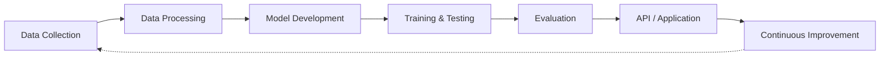

<div align="center">


<br/><br/>

<a href="https://github.com/HadiaWaheed"></a>
<a href="https://www.linkedin.com/in/hadia-waheed-1647892aa/"></a>
<a href="mailto:hadiawaheed5@gmail.com"></a>

</div>

---

## 👩‍💻 About Me

Hi, I'm **Hadia Waheed**, an **AI/ML Engineer** passionate about building intelligent systems, training machine learning models, and creating practical AI-powered applications.

I enjoy exploring how **machine learning, deep learning, and large language models** solve real-world problems. My interests span the complete AI journey, from data exploration and model experimentation to semantic retrieval, LLM integration, and backend development.

```python
profile = {
    "name": "Hadia Waheed",
    "role": "AI/ML Engineer",
    "interests": [
        "Machine Learning",
        "Deep Learning",
        "Natural Language Processing",
        "Large Language Models",
        "Generative AI",
        "RAG Systems"
    ],
    "mindset": "Learn. Build. Experiment. Improve.",
    "status": "Always building something."
}
```

---

## 🎯 Focus Areas

<div align="center">

| 🤖 Machine Learning | 🧠 Deep Learning | ✨ Generative AI |
|:---:|:---:|:---:|
| Model Training | Neural Networks | LLMs |
| Classification | Transformers | RAG Systems |
| Evaluation | Fine-Tuning | Semantic Search |

</div>

---

## 🛠️ Tech Stack

**Core ML**

<p>


</p>

**LLM & Retrieval**

<p>


</p>

**Backend & Database**

<p>


</p>

**Tools**

<p>


</p>

**AI Concepts:** LLMs · RAG · Transformers · Sentence Embeddings · Vector Search · Prompt Engineering · Fine-Tuning & Evaluation

---

## 🚀 Featured Projects

### 🛡️ PolyGuard: AI-Powered Code Vulnerability Detection


A multilingual code vulnerability detection system that identifies potentially vulnerable source code using transformer-based deep learning.

- GraphCodeBERT-based vulnerability classification
- Model training, fine-tuning, and evaluation
- Multilingual source-code analysis
- API integration for code scanning

**Stack:** Python · PyTorch · GraphCodeBERT · Flask · PostgreSQL

🔗 [Explore PolyGuard](https://github.com/HadiaWaheed/PolyGuard)

---

### 📚 Comparative Religion RAG: Knowledge Q&A System


A question-answering application for exploring atheism, Islam, and comparative religion using a curated collection of books and documents.

- PDF processing and text extraction
- Chunking and embedding generation
- FAISS-based semantic vector retrieval
- Context-aware answer generation with Gemini

**Stack:** Python · FAISS · Sentence Transformers · Gemini API · FastAPI

🔗 [Explore ComparativeReligionBooks](https://github.com/SENODROOM/ComparativeReligionBooks)

---

### 🔍 FlyRank ML: Search Data Analysis


A practical ML project on search data exploration, problem formulation, experimentation, and predictive modeling.

- Exploratory data analysis
- ML task framing and baseline models
- Model experimentation and comparison
- Performance evaluation

**Stack:** Python · Pandas · Scikit-learn · Jupyter Notebook

🔗 [Explore FlyRank ML](https://github.com/HadiaWaheed/flyrank-ml-internship)

---

## 🔄 How I Build AI Systems



I focus on understanding the complete workflow behind intelligent systems: not just using AI models, but understanding how they are developed, evaluated, and integrated into practical applications.

---

## 📊 GitHub Stats

<div align="center">


<br/><br/>


</div>

---

<div align="center">

*Great engineering is not just about writing code. It is about understanding problems, exploring ideas, and building solutions that make a difference.*

<br/>

**Have an interesting AI idea, project, or collaboration in mind? Let's connect.**

<br/>

<a href="https://www.linkedin.com/in/hadia-waheed-1647892aa/"></a>
<a href="mailto:hadiawaheed5@gmail.com"></a>
<a href="https://github.com/HadiaWaheed"></a>

<br/><br/>

**THANK YOU FOR VISITING MY PROFILE** 💙

</div>


